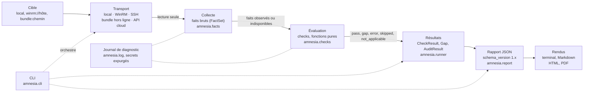

# Architecture

Ce document décrit le flux d'un audit, les modules de `src/amnesia/`, les
dépendances qu'ils ont le droit d'avoir entre eux et les frontières de
confiance que les données traversent. Le « pourquoi » de chaque choix
structurant est dans le registre des décisions, [`docs/adr/`](adr/README.md) ;
les menaces et leurs mesures sont dans [`docs/threat-model.md`](threat-model.md).

`tests/test_architecture.py` vérifie que ce document et le code restent
alignés : chaque module de `src/amnesia/` a sa ligne dans la table des
dépendances, et aucun import interne ne sort de ce qu'elle autorise.

## Flux d'un audit

Un audit est une chaîne à sens unique : la cible n'est jointe que par un
transport, le transport ne produit que des faits, les checks ne lisent que des
faits, et seuls les résultats entrent dans le rapport.

| Étape | Code | Ce qui entre | Ce qui sort | Décision |
|---|---|---|---|---|
| Cible | `amnesia.target` | `--target` (`local`, `winrm://<hôte>[:port]`, `bundle:<chemin>`) | `Target` validé : genre (`windows_host`...), transport, hôte ou chemin ; forme normalisée `Target.id` | [ADR 0007](adr/0007-transports.md) |
| Transport | collecteurs de `amnesia.facts.collectors` | `Target`, noms de faits, délai | connexion ou lecture de fichier, **en lecture seule** | [ADR 0006](adr/0006-garantie-lecture-seule.md), [ADR 0007](adr/0007-transports.md) |
| Collecte | `amnesia.facts` (`Fact`, `FactSet`, `CachingCollector`, enveloppe `amnesia.facts/1`) | ce que le transport a lu | faits `ok` (valeur) ou `unavailable` (motif), un par clé, collectés une fois par audit | [ADR 0004](adr/0004-separation-collecte-evaluation.md) |
| Évaluation | `amnesia.checks` (`Check.evaluate`, registre, `resolve()`) | `FactSet`, `Context` | `CheckResult` : `pass`, `gap` (avec des `Gap`), `error`, `skipped` ou `not_applicable` | [ADR 0004](adr/0004-separation-collecte-evaluation.md) |
| Résultats | `amnesia.runner` (`run_audit`, `AuditResult`, `AuditSummary`) | checks, cible, collecteur | résultats triés par sévérité, comptes, `complete`, `interrupted` | — |
| Rapport JSON | `amnesia.report` (`build_report`, `dumps_report`, schéma `report-v1`) | `AuditResult`, `argv` | document versionné, déterministe, validé par le schéma ([`format-rapport.md`](format-rapport.md)) | [ADR 0005](adr/0005-versionnage-du-schema-de-rapport.md) |
| Rendus | #23 (terminal, Markdown), #77 (HTML, PDF) | le rapport JSON, jamais les objets internes | documents lisibles ; hors des surfaces publiques ([`RELEASING.md`](RELEASING.md)) | [ADR 0005](adr/0005-versionnage-du-schema-de-rapport.md) |

Deux règles traversent toute la chaîne :

- **ce qui n'a pas été évalué n'est jamais conforme** : un fait indisponible
  devient un résultat `error`, `skipped` ou `not_applicable` (`resolve()`),
  jamais un `pass` ni un Gap (#15, #20) ;
- **rien ne remonte vers la cible** : aucune étape n'écrit sur la cible, et les
  seules sorties d'un audit sont le rapport, le journal de diagnostic et, en
  mode hors ligne, le bundle produit par le collecteur autonome (#48).

État au 29/10/2026 : la commande `audit` de la CLI est encore un squelette
(branchement de `run_audit` et de `build_report` : #24) ; `LocalCollector` ne
collecte rien encore (#48) ; WinRM, SSH, bundle et cloud sont à venir.

## Modules et dépendances autorisées

Les modules forment des couches ; une couche n'importe que les couches plus
basses. De bas en haut :

1. **socle sans dépendance interne** : `amnesia.target` (cibles et transports),
   `amnesia.log` (journal expurgé), `amnesia.facts.model` (faits) ;
2. **modèle des checks** : `amnesia.checks.base` (`Check`, `CheckResult`,
   `Gap`), `amnesia.checks.context`, `amnesia.checks.registry` ;
3. **collecte et résolution** : `amnesia.facts.collectors`,
   `amnesia.facts.resolution` ;
4. **checks de domaine** : `amnesia.checks.windows`, `amnesia.checks.ad` ;
5. **moteur et rapport** : `amnesia.runner`, puis `amnesia.report` ;
6. **entrée** : `amnesia.cli`, `amnesia.__main__`.

Table des dépendances internes autorisées (imports exécutés au chargement ;
un import sous `if TYPE_CHECKING:` ne compte pas, il ne crée aucun cycle à
l'exécution). `amnesia` désigne le seul paquet racine (`__version__`), pas ses
sous-modules ; `<domaine>` désigne un paquet de checks (`windows`, `ad`) et ses
modules.

| Module | Dépendances internes autorisées |
|---|---|
| `amnesia` | `amnesia.runner` |
| `amnesia.__main__` | `amnesia.cli` |
| `amnesia.cli` | `amnesia`, `amnesia.checks`, `amnesia.log`, `amnesia.report`, `amnesia.target` |
| `amnesia.report` | `amnesia.checks`, `amnesia.runner`, `amnesia.target` |
| `amnesia.runner` | `amnesia`, `amnesia.checks`, `amnesia.facts`, `amnesia.log`, `amnesia.target` |
| `amnesia.checks` | `amnesia.checks.base`, `amnesia.checks.registry` |
| `amnesia.checks.<domaine>` | `amnesia.checks.base`, `amnesia.checks.registry`, `amnesia.target` |
| `amnesia.checks.registry` | `amnesia.checks.base`, `amnesia.target` |
| `amnesia.checks.context` | `amnesia.target` |
| `amnesia.checks.base` | aucune |
| `amnesia.facts` | `amnesia.facts.collectors`, `amnesia.facts.model`, `amnesia.facts.resolution` |
| `amnesia.facts.resolution` | `amnesia.checks.base`, `amnesia.facts.model` |
| `amnesia.facts.collectors` | `amnesia.facts.model`, `amnesia.target` |
| `amnesia.facts.model` | aucune |
| `amnesia.log` | aucune |
| `amnesia.target` | aucune |

Ce que la table interdit, et pourquoi :

- **un check n'importe ni collecteur, ni moteur, ni rapport, ni CLI** : il ne
  reçoit que des faits et un contexte, et peut donc être testé sous Linux avec
  des faits enregistrés (`FixtureCollector`) ;
- **un module de check n'importe aucun module d'I/O** de la bibliothèque
  standard (`subprocess`, `socket`, `os`, `pathlib`, `shutil`, `urllib`,
  `http`, `winreg`, `ctypes`) ni de SDK (`winrm`, `ldap3`, `boto3`, `msgraph`) :
  `evaluate()` est une fonction pure, et un check ne peut pas écrire sur la
  cible même par erreur ([ADR 0006](adr/0006-garantie-lecture-seule.md)) ;
- **la collecte ne connaît pas le moteur** : un collecteur se remplace par un
  autre (local, WinRM, bundle) sans toucher aux checks ni au moteur ;
- **le rapport lit des résultats, jamais la cible** ; les rendus lisent le
  rapport JSON, jamais les objets Python : le contrat machine est le seul point
  de passage ([ADR 0005](adr/0005-versionnage-du-schema-de-rapport.md)) ;
- **`amnesia.cli` n'est importé que par `__main__`** : l'API Python
  (`from amnesia import run_audit`) ne dépend pas de la ligne de commande.

Une dépendance est **dynamique** : le registre (`amnesia.checks.registry`)
importe les paquets de domaine par leur nom (`importlib`) au premier besoin,
pour que `amnesia.checks` ne charge aucun check à l'import. Le test AST ne la
voit pas ; elle est bornée par la liste des domaines du registre (`Domain`).

Les dépendances tierces (SDK WinRM, LDAP, Graph, boto3) arrivent par les
transports et les collecteurs, jamais par les checks. Elles seront des extras
optionnels (#95) : un poste qui n'audite que des bundles n'installe aucun SDK.

## Frontières de confiance

Les zones de confiance sont celles du modèle de menace (`Z1` à `Z5`,
[`threat-model.md`](threat-model.md), section « Flux ») ; ce document ne les
redéfinit pas, il dit quelle étape du flux les traverse.

| Frontière | Étape du flux | Ce qui la traverse | Mesures |
|---|---|---|---|
| Z1 → Z2, Z1 → Z3 (poste → cibles) | Transport | authentification, puis lecture de configurations | lecture seule ([ADR 0006](adr/0006-garantie-lecture-seule.md)), périmètre autorisé (#37), transports chiffrés et authentifiés ([ADR 0007](adr/0007-transports.md)) |
| Z2 → Z1 (cibles → poste) | Collecte | sorties de commandes, fichiers, bundles : données d'une cible **peut-être compromise** (H4) | tout texte venu de la cible est caviardé et rendu imprimable avant d'entrer dans un résultat (`assainir`) ; valeurs figées et bornées (`Evidence`) ; bundle vérifié par empreintes (#52) ; aucune analyse de texte localisé |
| Z1 → Z4 (poste → destinataires) | Rapport, rendus | le rapport : la carte des angles morts du client | déterminisme, caractères de contrôle échappés, `argv` expurgé ([`format-rapport.md`](format-rapport.md)) ; règles de remise dans `SECURITY.md` |
| Z5 → Z1 (chaîne d'approvisionnement → poste) | installation | code d'amnesia et de ses dépendances | versions exactes, lock avec empreintes, délai de carence ([`dev/dependances.md`](dev/dependances.md)) |

À l'intérieur de Z1, la frontière interne qui compte est celle entre la collecte
et l'évaluation : les identifiants d'audit ne vont que vers les transports, et
les checks n'en voient jamais. Le journal de diagnostic (`amnesia.log`) est
expurgé par construction, quel que soit le module qui écrit.

## Cycle de vie des données

Ce que produit un audit, où cela vit et quand cela disparaît (minimisation :
#41 ; règles de conservation : `SECURITY.md`) :

| Donnée | Portée | Où | Fin de vie |
|---|---|---|---|
| Identifiants et jetons d'audit | transport | trousseau ou environnement du poste, jamais dans un fichier d'amnesia | hors d'amnesia ; jamais dans le rapport ni le journal (expurgation) |
| Faits collectés (`FactSet`) | un audit | mémoire du processus (`CachingCollector`, une instance par audit) | fin du processus ; rien ne persiste entre deux audits |
| Bundle hors ligne | mission | fichier remis par le client, lu par `bundle:<chemin>` | conservé selon les règles de `SECURITY.md` ; jamais commité (`raw/`, hooks) |
| Rapport JSON | mission | `--out`, poste de l'auditeur | remis au client, puis conservé ou détruit selon `SECURITY.md` |
| Journal de diagnostic | une exécution | stderr, ou `--log-file` créé en `0600` | à la discrétion de l'auditeur ; ne contient aucun secret |

## Pour aller plus loin

- [`docs/dev/faits.md`](dev/faits.md) : enveloppe des faits, collecteurs,
  écriture d'un check ;
- [`docs/format-rapport.md`](format-rapport.md) : champs et compatibilité du
  rapport ;
- [`docs/RELEASING.md`](RELEASING.md) : surfaces publiques et versionnage ;
- [`docs/adr/README.md`](adr/README.md) : registre des décisions.
