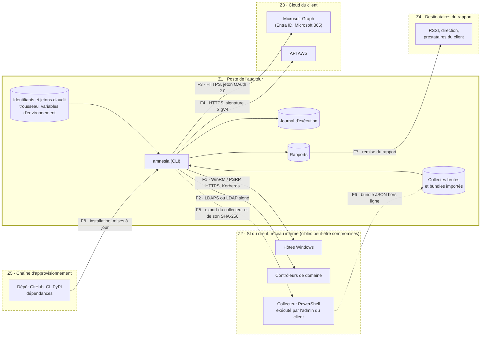

# Modèle de menace

amnesia manipule des identifiants privilégiés (WinRM, LDAP, Microsoft Graph,
AWS), se connecte à des hôtes peut-être déjà compromis et produit un livrable qui
sert de carte à un attaquant : la liste de ce qu'un SI ne journalise pas. Ce
document recense, selon la méthode STRIDE, les menaces qui pèsent sur l'outil, sur
ceux qui l'utilisent et sur leurs clients, et la mesure qui répond à chacune. Il
sert de source aux règles de `SECURITY.md` (#28).

**État des mesures.** Le code n'est encore qu'un squelette (README, section
« État »). Parmi les mesures citées, seules celles de #3 (versions exactes, lockfile
avec empreintes, délai de carence), #6 (hooks anti-fuite) et #7 (CI durcie,
gitleaks côté serveur) sont en place. Celles de #3 ne protègent que le développement
et la CI : une installation depuis PyPI ne lit ni le lock ni le délai de carence
(M21, RR10). Les autres sont prévues par leur ticket : tant que celui-ci n'est pas
mergé, la menace n'est pas traitée.

**Identifiants.** Zones `Z`, flux `F`, actifs `A`, acteurs `AC`, menaces `M` et
risques résiduels `RR` gardent leur identifiant d'une révision à l'autre :
`SECURITY.md`, les tickets et les PR y renvoient. Un identifiant retiré n'est jamais
réattribué.

## Méthode

Chaque menace porte une seule catégorie STRIDE, celle de son effet principal. Une
menace qui a deux effets distincts est découpée en deux lignes.

| Lettre | Catégorie | Propriété violée |
|---|---|---|
| S | Usurpation d'identité (*spoofing*) | Authentification |
| T | Altération (*tampering*) | Intégrité |
| R | Répudiation (*repudiation*) | Non-répudiation |
| I | Divulgation d'information (*information disclosure*) | Confidentialité |
| D | Déni de service (*denial of service*) | Disponibilité |
| E | Élévation de privilèges (*elevation of privilege*) | Autorisation |

Référence : [catégories STRIDE de Microsoft](https://learn.microsoft.com/azure/security/develop/threat-modeling-tool-threats).

## Périmètre et hypothèses

Le modèle couvre la CLI amnesia exécutée sur le poste de l'auditeur, ses transports
et connecteurs, le collecteur hors ligne, les livrables, ainsi que la chaîne qui
produit et distribue l'outil (dépôt, CI, PyPI).

- **H1** : le poste de l'auditeur est sain au début de la mission (poste géré,
  système à jour, disque chiffré). Sa compromission est un risque résiduel (RR1).
- **H2** : l'auditeur agit sur mandat écrit du client, qui fixe le périmètre (#37).
- **H3** : le système d'exploitation et l'interpréteur Python du poste sont de
  confiance.
- **H4** : les cibles ne sont pas de confiance. Toute donnée qui en vient, en ligne
  ou dans un bundle, est une entrée hostile.

Les transports et connecteurs qui n'existent pas encore (SSH #119, vSphere #123,
SIEM #112, #113 et #156) seront ajoutés par la règle de révision, dans la PR qui
les introduit.

Hors périmètre : `SECURITY.md` (#28) et le guide d'exploitation (#82), qui
s'appuient sur ce document.

## Flux

Chaque sous-graphe est une zone de confiance : ses bords sont les frontières. Une
flèche qui sort d'une zone franchit une frontière de confiance, et c'est là que
s'appliquent les mesures. Les flèches indiquent qui initie l'échange : F1 à F4
ramènent aussi des données de la cible vers Z1. Tout flux qui quitte Z1 traverse un
réseau non fiable (réseau du client, VPN, Wi-Fi, Internet), où peut se trouver un
tiers (AC4).

| Zone | Contenu | Confiance |
|---|---|---|
| Z1 | Poste de l'auditeur : amnesia, identifiants, collectes brutes, rapports, journal d'exécution | De confiance (H1) |
| Z2 | SI du client, réseau interne : hôtes Windows, contrôleurs de domaine, collecteur hors ligne | Non fiable : chaque cible peut être compromise (H4) |
| Z3 | Cloud du client : Microsoft Graph (Entra ID, Microsoft 365), API AWS | Service tenu pour fiable, contenu du tenant non fiable |
| Z4 | Destinataires du rapport | Légitimes, hors de tout contrôle technique après remise |
| Z5 | Chaîne d'approvisionnement : dépôt, CI, PyPI, dépendances | Conditionnelle : empreintes du lock et délai de carence en développement et en CI (#3) ; chez l'utilisateur, attestations du seul paquet amnesia (#33) |

| Flux | Origine → destination | Frontière | Transport | Données | Tickets |
|---|---|---|---|---|---|
| F1 | amnesia → hôtes Windows | Z1 → Z2 | WinRM/PSRP : HTTPS 5986 avec validation du certificat, Kerberos par défaut ; HTTP 5985 seulement avec chiffrement des messages | Authentification, collecteur PowerShell figé, configurations renvoyées | #63, #64 |
| F2 | amnesia → contrôleurs de domaine | Z1 → Z2 | LDAPS 636, ou LDAP 389 avec signature et scellement SASL ; jamais de bind simple en clair | Authentification, objets AD, SACL | #66, #69 |
| F3 | amnesia → Microsoft Graph | Z1 → Z3 | HTTPS, jeton OAuth 2.0 obtenu par certificat ou identité fédérée | Jeton, paramètres d'audit et de rétention du tenant | #95, #99 |
| F4 | amnesia → API AWS | Z1 → Z3 | HTTPS, requêtes signées SigV4, rôle assumé avec `ExternalId` | Identifiants temporaires, configuration CloudTrail | #95, #109 |
| F5 | amnesia → administrateur du client | Z1 → Z2 | Export du collecteur hors ligne avec son SHA-256, transmis par le canal choisi par le client | Script PowerShell exécuté avec les droits de l'admin du client | #48, #151 |
| F6 | Collecteur hors ligne → amnesia | Z2 → Z1 | Bundle JSON transmis par le client (support amovible, partage, messagerie), audité en mode offline | Configurations collectées, manifeste et empreintes | #48, #52, #35 |
| F7 | Rapport → client | Z1 → Z4 | Fichier remis par messagerie ou partage, chiffré si demandé | Rapport JSON, Markdown, HTML ou PDF | #25, #79, #144, #145 |
| F8 | Chaîne d'approvisionnement → poste | Z5 → Z1 | Installation depuis PyPI (pip, pipx, uv tool) : dépendances résolues au moment de l'installation sur des bornes basses (#44), sans empreinte ni délai de carence ; le lock avec empreintes (#3) ne couvre que le développement et la CI ; attestations du paquet amnesia vérifiables (#33) | Code d'amnesia et de ses dépendances | #33, #44, #153 |

## Actifs

| ID | Actif | Pourquoi il compte | Propriété à protéger |
|---|---|---|---|
| A1 | Identifiants et jetons d'audit | Comptes WinRM et LDAP, certificats d'application Entra, clés et rôles AWS : des accès privilégiés au SI du client, réutilisables par un attaquant | Confidentialité |
| A2 | Collectes brutes | Configurations, noms d'hôtes, comptes, adresses IP : données du client, parfois personnelles (#41) | Confidentialité, intégrité |
| A3 | Rapports | Carte des angles morts du client : ce qu'un attaquant peut faire sans laisser de traces | Confidentialité, intégrité |
| A4 | Journal d'exécution | Preuve de ce qu'amnesia a fait, où, quand et avec quel compte (#40) | Intégrité |
| A5 | Intégrité des cibles | amnesia ne doit ni modifier ni dégrader les systèmes qu'il audite | Intégrité, disponibilité |
| A6 | Confiance du client | Dans l'outil, dans le consultant et dans l'exactitude du rapport : c'est ce qui se vend | Intégrité |
| A7 | Code et artefacts publiés d'amnesia | Paquet exécuté chez chaque utilisateur avec les identifiants d'audit | Intégrité |

## Acteurs

Sources de menace, malveillantes ou non.

| ID | Acteur | Capacités et motivation | Flux exposés |
|---|---|---|---|
| AC1 | Cible compromise | Attaquant déjà présent sur un hôte ou dans un tenant audité : il contrôle les réponses et les fichiers renvoyés, et voit les authentifications qu'on lui présente | F1, F2, F3, F4, F6 |
| AC2 | Consultant ou opérateur MSP | De bonne foi mais faillible : faute de frappe sur une cible, mauvais client, commit accidentel, poste volé ou perdu | Z1, tous les flux |
| AC3 | Destinataire du rapport | Légitime, mais peut diffuser le rapport au-delà du cercle prévu, ou voir sa messagerie compromise | F7 |
| AC4 | Tiers sur le réseau | Attaquant en position d'intermédiaire (Wi-Fi, réseau du client, proxy, DNS) : écoute, modifie ou usurpe | F1, F2, F3, F4, F5, F6 |
| AC5 | Fournisseur de dépendance | Paquet malveillant ou compromis (typosquat, compte de mainteneur volé), usurpation du nom d'amnesia sur PyPI, ou compromission de la chaîne de publication d'amnesia | F8 |

## Menaces et mesures

| ID | STRIDE | Menace | Acteur | Actifs | Mesures | Tickets |
|---|---|---|---|---|---|---|
| M01 | E | Script injecté dans un rendu HTML ou Markdown (XSS) par une valeur renvoyée par la cible (nom de GPO, d'hôte, d'application Entra, tag AWS), puis exécuté dans le navigateur de l'auditeur ou du client | AC1 | A3, A6 | Échappement par contexte de sortie de toute chaîne issue d'une cible ; rapport HTML autonome avec CSP `default-src 'none'` | #45, #77 |
| M02 | T | Séquences ANSI ou OSC, caractères de contrôle ou bidirectionnels renvoyés par une cible, qui falsifient l'affichage du terminal (lignes effacées, faux constat, lien trompeur) ; formule injectée dans un export CSV | AC1 | A6 | Suppression des caractères de contrôle et des séquences d'échappement, neutralisation des formules | #45 |
| M03 | E | Fichier importé piégé (zip slip, lien symbolique, entités XML externes) qui écrit ou lit hors du dossier prévu sur le poste de l'auditeur | AC1 | A1, A2 | Module d'entrée unique, `defusedxml`, refus des chemins absolus, des `..` et des liens, extraction dans un dossier en 0700 | #35, #52 |
| M04 | D | Fichier importé démesuré (bombe de décompression, *billion laughs*, structure pathologique) qui épuise la mémoire ou le disque du poste | AC1 | A2 | Plafonds sur les octets réellement lus, le nombre d'entrées et le ratio de compression | #35 |
| M05 | S | Capture d'identifiants par une cible compromise pour usurper le compte d'audit : délégation CredSSP qui lui remet le mot de passe, réponse NTLMv2 cassée hors ligne ou relayée | AC1 | A1 | Basic et CredSSP refusés ; Kerberos seul par défaut, sans délégation ; NTLM seulement avec `--allow-ntlm` ; compte JEA dédié ; secrets propres à chaque mission | #63, #64, #38 |
| M06 | E | Identifiants d'audit plus privilégiés que nécessaire (Domain Admin, Global Admin, `ReadOnlyAccess` AWS) : leur capture donne bien plus que la lecture de configurations | AC1 | A1, A5 | Privilèges documentés par check et commande preflight ; endpoint JEA ; jeton Microsoft refusé s'il porte une permission d'écriture ; rôle AWS limité aux actions Describe, Get et List utilisées | #42, #64, #95, #99, #109 |
| M07 | S | Faux service qui se fait passer pour la cible (DNS ou ARP empoisonné, proxy) pour recueillir les identifiants ou servir de fausses réponses | AC4 | A1, A6 | Validation du certificat TLS sans option pour la désactiver ; authentification mutuelle Kerberos ; proxy ignoré pour WinRM ; LDAPS ou LDAP signé ; disjoncteur au premier échec d'authentification | #63, #66, #43 |
| M08 | I | Écoute du trafic d'audit : configurations, jetons, échanges d'authentification | AC4 | A1, A2 | HTTPS par défaut pour WinRM, HTTP seulement avec chiffrement des messages et drapeau explicite ; LDAPS ou scellement SASL ; HTTPS pour Graph et AWS | #63, #66, #95 |
| M09 | T | Modification des réponses en transit pour masquer une lacune ou injecter des données hostiles | AC4 | A6 | Intégrité assurée par TLS, le chiffrement des messages WinRM ou la signature LDAP ; neutralisation des rendus en défense en profondeur | #63, #66, #45 |
| M10 | E | Audit d'une cible hors du périmètre autorisé (faute de frappe, filiale non couverte, autre client d'un MSP) : accès sans mandat | AC2 | A5, A6 | Fichier de scope vérifié avant toute connexion, sur la forme normalisée de la cible, avec période de validité et exclusions prioritaires | #37, #18 |
| M11 | T | Modification accidentelle d'une cible (commande en écriture, effacement de journal) par erreur de code ou d'usage | AC2 | A5 | Allowlist des opérations testée en CI ; endpoint JEA sans commande libre | #39, #64 |
| M12 | D | Surcharge des cibles ou verrouillage du compte d'audit (rafale d'échecs d'authentification, sessions simultanées sur les contrôleurs de domaine), qui peut aussi déclencher un incident au SOC du client | AC2 | A5, A6 | Disjoncteur d'authentification, première authentification sérialisée, timeouts, plafonds de parallélisme et de débit | #43, #65 |
| M13 | R | Contestation des actions menées sur une cible : impossible de prouver qui a fait quoi, quand et avec quel compte | AC2 | A4, A6 | Journal d'exécution chaîné par SHA-256, plan d'audit `--dry-run`, User-Agent identifiable | #40 |
| M14 | R | Contestation des constats ou du rapport après remise (rapport modifié, collecte niée) | AC3 | A3, A6 | Pack de preuves avec manifeste et empreintes ; signature des livrables | #146, #151 |
| M15 | I | Vol ou perte du poste de l'auditeur | AC2 | A1, A2, A3 | Chiffrement du disque (prérequis d'exploitation, #82) ; secrets dans le trousseau du système, jamais en clair ; fichiers en 0600 et dossiers en 0700 ; rapport chiffré | #38, #25, #145 |
| M16 | I | Commit accidentel d'un rapport ou d'un secret dans un dépôt git | AC2 | A1, A3 | Hooks de refus et gitleaks, rejoués en CI sur tout l'historique ; sortie par défaut dans `amnesia-out/`, avertissement si la destination est suivie par git | #6, #7, #25 |
| M17 | I | Secrets dans les journaux, les messages d'erreur, les traces d'exception ou `argv` (visible dans `ps` et l'historique du shell) | AC2 | A1 | Type `Secret` masqué ; aucune option CLI ne prend une valeur secrète ; filtre d'expurgation et loggers tiers plafonnés | #19, #38 |
| M18 | I | Contamination croisée entre clients d'un MSP : identifiants, collectes ou résultats d'un client dans la mission d'un autre | AC2 | A1, A2, A3, A6 | Isolation par mission : répertoire en 0700, scope, secrets et sorties propres à chaque mission | #148 |
| M19 | I | Envoi de données vers un tiers par amnesia ou l'une de ses dépendances : télémétrie d'un SDK, vérification de mise à jour, ressource externe chargée par un rendu | AC5 | A2, A3, A6 | Aucune télémétrie ni connexion non sollicitée, réseau réservé aux collecteurs ; rendus sans ressource externe | #26, #77 |
| M20 | I | Fuite du rapport par un destinataire : transfert, messagerie compromise, partage trop large | AC3 | A3, A6 | Marquage de confidentialité et de diffusion ; chiffrement pour des destinataires nommés ; version expurgée et pseudonymisée pour les diffusions larges | #79, #145, #144 |
| M21 | T | Dépendance malveillante ou compromise (typosquat, version piégée, compte de mainteneur volé) résolue à l'installation chez l'utilisateur, hors lock et sans délai de carence, puis exécutée avec les identifiants d'audit | AC5 | A1, A2, A3 | Extras optionnels pour réduire la surface ; politique d'acceptation des dépendances ; SBOM des dépendances d'exécution à chaque release. Aucune empreinte n'est imposée à l'installation : risque résiduel RR10 | #44, #153 |
| M22 | T | Compromission de la chaîne de publication (CI, jeton PyPI, release modifiée) : paquet amnesia piégé distribué aux utilisateurs | AC5 | A6, A7 | CI durcie ; Trusted Publishing et attestations, sans jeton longue durée ; signature ; SBOM et provenance | #7, #33, #151, #153 |
| M23 | T | Collecteur PowerShell modifié entre son export et son exécution chez le client, qui s'exécute alors avec les droits de l'administrateur du client | AC4 | A5, A6 | Script figé, exporté avec son SHA-256 ; signature Authenticode | #48, #151 |
| M24 | T | Dépendance de développement ou de build malveillante ou compromise (typosquat, version piégée, compte de mainteneur volé), exécutée sur un poste de développement ou en CI, qui vole les secrets du dépôt ou piège le paquet amnesia construit | AC5 | A7 | Versions exactes, lockfile avec empreintes vérifié par `uv sync --locked`, délai de carence de 7 jours, backend de build figé ; audit des vulnérabilités et Dependabot | #3, #8 |
| M25 | S | Paquet qui usurpe le nom d'amnesia sur PyPI : `amnesia-dfr` n'est pas encore réservé et n'importe qui peut l'enregistrer, et `pip install amnesia` installe un paquet sans rapport. Installé à la place d'amnesia, il s'exécute avec les identifiants d'audit | AC5 | A1, A6 | Nom réservé par une première release fonctionnelle publiée par Trusted Publishing ; ligne d'installation du README avec le nom exact `amnesia-dfr` ; procédure de vérification des attestations | #33, #153 |

## Couverture STRIDE

Les six catégories sont couvertes : aucune absence n'est à justifier.

| Lettre | Menaces |
|---|---|
| S | M05, M07, M25 |
| T | M02, M09, M11, M21, M22, M23, M24 |
| R | M13, M14 |
| I | M08, M15, M16, M17, M18, M19, M20 |
| D | M04, M12 |
| E | M01, M03, M06, M10 |

## Risques résiduels

Menaces que le projet ne traite pas, ou seulement en partie, et pourquoi.

| ID | Risque | Justification |
|---|---|---|
| RR1 | Poste de l'auditeur compromis pendant la mission (logiciel malveillant, accès administrateur) | Une application ne peut pas se défendre contre le système qui l'exécute : secrets en mémoire, frappes et rapports y sont exposés. C'est l'hypothèse H1 ; les prérequis du poste (poste géré, EDR, disque chiffré, compte dédié) relèvent du guide d'exploitation (#82). |
| RR2 | Cible compromise qui ment sur sa propre configuration (réponses d'auditpol ou du registre falsifiées, bundle réécrit avant transmission) | amnesia lit ce que la cible déclare : un attaquant administrateur de l'hôte peut tout falsifier, et aucune lecture logicielle ne le prouve sans attestation matérielle, hors de l'objet de l'outil. Atténuation partielle : confrontation avec ce que le SIEM reçoit réellement (#114, #115) et avec la fenêtre réelle des journaux (#55). |
| RR3 | Opérateur malveillant disposant d'identifiants légitimes | Il peut s'en servir hors d'amnesia, où aucun contrôle de l'outil ne s'applique. Cela relève du contrat et de l'organisation (#89). Le moindre privilège (#42) et JEA (#64) bornent ce que ces identifiants permettent ; le journal d'exécution (#40) ne trace que ce qui passe par amnesia. |
| RR4 | Secrets présents dans la mémoire du processus Python | Les chaînes Python sont immuables et l'interpréteur peut les copier : leur effacement fiable est impossible. Atténuation : processus de courte durée, secrets lus au dernier moment (#38). Lire cette mémoire suppose un poste déjà compromis (RR1). |
| RR5 | Diffusion d'un rapport par un destinataire légitime après déchiffrement | Aucune mesure technique ne contrôle un document une fois remis ; un DRM serait contournable et gênerait l'usage. Le marquage (#79) et la version expurgée (#144) réduisent l'exposition ; le reste relève du contrat. |
| RR6 | Privilèges élevés imposés par certaines lectures | Windows exige SeSecurityPrivilege, ou un droit équivalent, pour `auditpol /get` et pour lire les SACL : le moindre privilège a un plancher. JEA (#64) confine ces droits à des fonctions de lecture et le preflight (#42) les documente. |
| RR7 | Activité d'audit visible par une cible compromise | Toute connexion révèle le compte utilisé, l'adresse IP source et l'heure : un attaquant présent sait qu'un audit a lieu. C'est inhérent à un audit en ligne ; le mode hors ligne (#48, #52) réduit cette exposition. |
| RR8 | Compromission d'un fournisseur cloud (Microsoft, AWS) | Les réponses de Microsoft Graph et des API AWS sont tenues pour fiables (zone Z3) : un client qui ne fait pas confiance à son fournisseur cloud sort du modèle, et amnesia n'a aucun moyen de le vérifier. |
| RR9 | Chaîne Go des hooks pre-commit téléchargée sans empreinte figée | Risque déjà accepté dans `.pre-commit-config.yaml` : il ne concerne que les postes de développement. La CI télécharge gitleaks et actionlint avec un SHA-256 figé et rejoue les contrôles sur tout l'historique (#7). |
| RR10 | Dépendances d'exécution résolues sans empreinte ni délai de carence à l'installation chez l'utilisateur (M21) | Un paquet publié sur PyPI ne transporte pas de lock : ses métadonnées `Requires-Dist` n'acceptent pas d'empreinte, et des versions exactes casseraient la cohabitation des extras avec l'environnement de l'utilisateur, d'où les seules bornes basses de #44. Les attestations (#33) ne couvrent que le paquet amnesia. Atténuation possible, que ne prévoit encore aucun ticket : publier à chaque release un fichier de dépendances figées avec empreintes (`uv export --all-extras` ou `pylock.toml` de la PEP 751), attesté avec le wheel, et documenter `pip install --require-hashes -r`, ou `uv tool install --exclude-newer`. À trancher dans #33 (release) et #82 (guide d'exploitation). |

## Révision

Ce document n'a de valeur que s'il suit le code.

- **Nouveau transport ou connecteur** : la PR qui introduit un nouveau transport
  (SSH, par exemple) ou un nouveau connecteur (SIEM, vSphere, nouvelle API cloud)
  met à jour ce document dans la même PR : zones et flux du schéma, tableau des flux,
  menaces et mesures. Le modèle de PR porte une case dédiée (#29).
- **Clôture de chaque milestone** : revue complète avant de fermer le milestone.
  On vérifie l'état des mesures (ticket mergé ou non), les tickets cités (un ticket
  fermé sans être réalisé rouvre la menace) et les risques résiduels encore
  acceptables. La revue est consignée dans l'historique ci-dessous, même sans
  changement.
- **Garde-fou** : `tests/test_modele_menace.py` vérifie la structure du document :
  catégorie STRIDE, mesure et ticket pour chaque menace, couverture des six
  catégories, acteurs et actifs définis, identifiants cités tous définis,
  justification de chaque risque résiduel.

## Historique

| Date | Révision | Ticket |
|---|---|---|
| 2026-10-26 | Version initiale | #27 |
